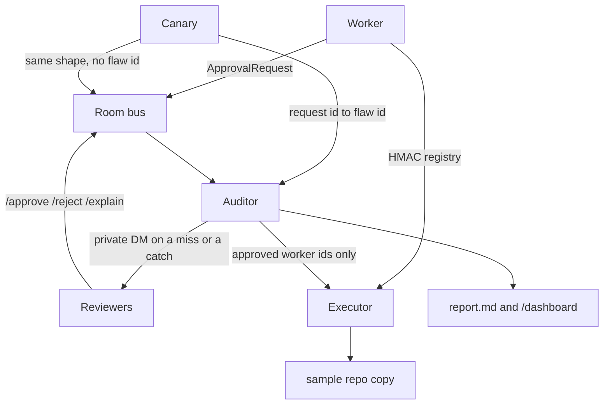

# Fire Drill

Teams put a human approve step in front of risky agent actions, and then nobody measures whether the human actually reads. Fire Drill is a shared room where a worker does real, safe edits, a canary posts the same kind of request with a deliberate flaw, and an auditor — the only one who knows which is which — times the decision, catches rubber-stamping, and writes the report. The canary never executes.

## Quick start

```bash
make setup
make test
firedrill run-demo --offline
firedrill report
firedrill verify
```

`make setup` creates a virtualenv, `auditor_private/` (mode 0700), and a gitignored `.env`. It installs `firedrill` into `.venv/bin`. Put that on `PATH` with `export PATH="$PWD/.venv/bin:$PATH"`, or prefix the drill commands with `uv run`. The demo runs without an API key. Add `XAI_API_KEY` only when you want the worker's one-line summaries to come from Grok; leave it empty and the offline templates are used.

## Architecture



The room bus is `LocalAdapter` (SQLite) unless you point `--adapter` at Mattermost or Switch. The executor is the only code that edits the repo, and it refuses any id that is not in the worker's HMAC registry. Canary ids are not in that registry.

## Three-minute demo

Record from the `fire-drill` directory:

```bash
make setup
firedrill run-demo --offline
firedrill report
firedrill verify
```

Narration you can read over those commands:

1. The worker posts real edits to a toy service. The canary posts twelve flawed requests in the same voice. Reviewers cannot tell them apart from the author line.
2. Avery reads and catches the canaries she is assigned. Blake approves in a few seconds and catches none. Casey catches the obvious flaws and misses the subtle ones. The flatness flag marks very fast times and times that barely vary.
3. `firedrill report` prints the headline from the database. The limits section says this is a method demo, not a significance claim.
4. `firedrill verify` recomputes SHA-256 of the revealed key and salt and checks it against the commitment posted when the drill started. The command prints the hash, not the key.

`firedrill replay demo/recorded_drill.jsonl` repeats that drill from the recording. A live room uses `firedrill consent <reviewer>` (the person types `/optin`) and `firedrill start` before any decisions.

## Answer-key threat model

The answer key is the map from request id to flaw, plus the bytes in `auditor_private/key.json`. That directory is mode 0700 and is not in git. `make setup-auditor` tries to create an OS user named `firedrill-auditor` with non-interactive `sudo`. On this Mac that needs an administrator password, so when sudo refuses, isolation is the token gate instead.

The auditor service binds to `127.0.0.1`. `AUDITOR_TOKEN` can read the key, the mappings, and `/dashboard`. `CANARY_INGEST_TOKEN` can only `POST /mappings`. The worker and the canary receive 401 on the key. The canary process is not given `WORKER_SECRET`, and `executor.py` will not apply an id the worker did not sign.

At the start the auditor posts `SHA-256(key.json bytes + newline + salt)`. At the end it posts the key and the salt so anyone can recompute the hash. A miss is a private DM (`PRIVATE CANARY RESULT`) to the reviewer who approved the canary. That text is not written to the room log. A correct rejection gets a private "nice catch" and still does not execute.

## Adapters

`firedrill up` defaults to the local SQLite room. That path is what the tests and the offline demo run.

Mattermost uses the preview image in `docker-compose.yml` on port 8065. That image has no `linux/arm64` manifest, so the compose file pins `platform: linux/amd64` for Apple Silicon. The adapter uses only these API v4 calls: `GET /api/v4/system/ping`, `GET /api/v4/users/me`, `POST /api/v4/posts`, `POST /api/v4/reactions`, and `POST /api/v4/channels/direct`. Set `MM_TOKEN` and `MM_CHANNEL_ID` in `.env`. The tool does not guess an admin password. If the server is up and the token is missing, `firedrill up --adapter mattermost` exits with those instructions.

Switch uses `GET /health` and `POST /agents/{id}/message` with `{room_id, content}`. Other operations are called only after `GET /agents/{id}/ops`, and only with argument names that schema lists. `switch/room-template.yaml` is template language version 1. The `provider` field is there because Console requires it for a coding agent it places on a machine. The drill's worker, canary, and auditor are the Python processes in this repo. `auto_approve` is false. No Switch Console was installed here, so the template has not been applied to a live server.

## Citations

- Anthropic, Claude Code auto mode: users accept 93% of permission prompts. <https://www.anthropic.com/engineering/claude-code-auto-mode>
- Anthropic, planted dangerous commands were caught 13.6% of the time. <https://claude.com/resources/articles/auto-mode-default-in-claude-code>
- Lane et al., Harvard Business School field experiment: LLM narrative explanations raised alignment with the AI by about 19 percentage points under cognitive load. <https://www.hbs.edu/faculty/Pages/item.aspx?num=66193>
- EU AI Act Article 14(4)(b): overseers must remain aware of the tendency to rely automatically on the output (automation bias). <https://ai-act-service-desk.ec.europa.eu/en/ai-act/article-14>
- Cemri et al., Berkeley, MAST: task verification failures are about 23.5% of multi-agent failures. <https://arxiv.org/abs/2503.13657>

The twelve canaries are tagged with MAST modes from that taxonomy, including disobeying the task or the role, ignoring another agent's input, a plan that does not match the diff, stopping early, and weak or wrong verification.

## Limits

The offline demo is 50 real edits and 12 canaries, decided by three simulated reviewers. That is enough to show the measurement. It is a small sample; it demonstrates the method, not statistical significance. Catch rate, median times, and the flatness flag are computed from the run. The headline in the report is that computation, not a number baked into the program.

