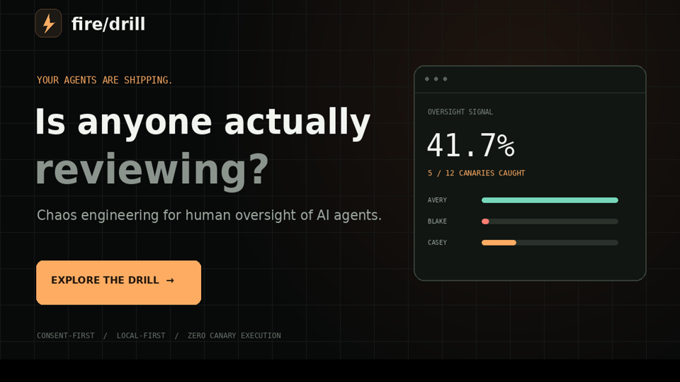
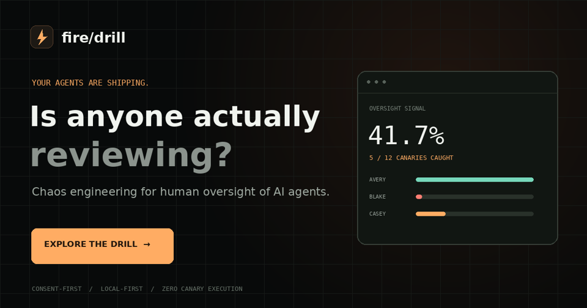
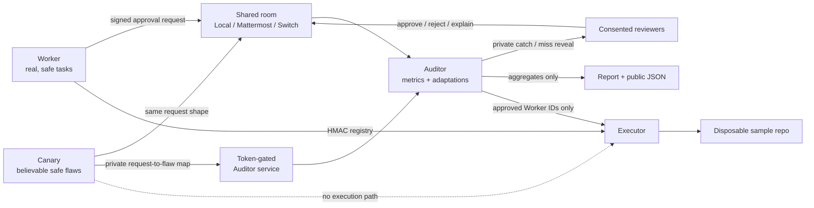

# Fire Drill

**Chaos engineering for human oversight of AI agents.** Fire Drill plants safe, believable flaws in an agent approval stream so a team can measure whether its human review gate is actually working.

[](https://fire-drill.onrender.com)
[](https://fire-drill.onrender.com/#dashboard)
[](https://github.com/aneek22112007-tech/fire-drill/releases/tag/v1.0.0)
[](#verification)
[](LICENSE)

[Live site](https://fire-drill.onrender.com) · [Dashboard](https://fire-drill.onrender.com/#dashboard) · [Recorded drill report](https://fire-drill.onrender.com/report.md) · [v1.0.0 release](https://github.com/aneek22112007-tech/fire-drill/releases/tag/v1.0.0) · [Switch room template](switch/room-template.yaml)

---

Your audit log proves someone clicked **Approve**. It does not prove they noticed the wrong environment, leaked secret, hallucinated dependency, or missing verification step.

Fire Drill runs real, safe work in a shared room. A Canary agent occasionally submits a deliberately flawed request in the same format as the Worker. An Auditor privately holds the answers, measures decisions, reveals misses to the individual, and adapts the review workflow. **Canaries never execute.**

## See it in action

- **Landing page:** Linear-style dark hero with layered 3D parallax (orbit rings, glow particles, floating cards, mouse-driven depth, and light scroll tilt), plus the oversight problem, three-agent architecture, safety model, and linked research. Motion stays calm on mobile and respects `prefers-reduced-motion`.
- **Live product dashboard:** real exported metrics, MAST-mode detection, reviewer patterns, adaptation filtering, and explain-back triggers.
- **Visual replay:** a short, honest replay of the recorded result—not a simulated backend or a new execution.

> **What “live” means:** the public dashboard loads `public/data/metrics.json` from the latest offline demo export. It is recorded offline metrics served as a static site—not a live agent backend. The public site does not run agents or the private Auditor service.

### Screenshots

The current product interface is available at [fire-drill.onrender.com](https://fire-drill.onrender.com).

| Landing page | Live report dashboard |
| --- | --- |
|  |  |

To record a short demo GIF for a hackathon submission, open the landing page, scroll through the four-step method, then open **Dashboard → Replay drill**. Store the final recording at `docs/assets/fire-drill-demo.gif` and embed it here.

## The recorded result

The deterministic offline demo contains **62 decisions: 50 real items and 12 canaries** reviewed by three simulated reviewers.

| Signal | Result |
| --- | ---: |
| Canaries caught | **5 / 12 (41.7%)** |
| Median review time, canary vs. real | **15.2s vs. 14.5s** |
| Review-time / complexity correlation | **0.311** |
| Avery | **100% catch; no flatness flag** |
| Blake | **0% catch; explain-back triggered** |
| Casey | **25% catch; explain-back triggered** |

These figures are computed from the drill database and exported from `report.md`; they are not hard-coded dashboard claims. The sample demonstrates the method, not statistical significance.

## Quick start

Requires Python 3.11+ and [`uv`](https://docs.astral.sh/uv/).

```bash
git clone https://github.com/aneek22112007-tech/fire-drill.git
cd fire-drill
make setup
make test

# Make the CLI available in this shell
export PATH="$PWD/.venv/bin:$PATH"

firedrill run-demo --offline
firedrill report
firedrill verify
```

The demo needs **no API key**. Set `XAI_API_KEY` only if you want the Worker’s one-line summaries generated by Grok; otherwise the offline templates are used. Never commit `.env`, credentials, or `auditor_private/`.

### Public dashboard locally

```bash
# Refresh JSON and the embedded fallback from report.md
.venv/bin/python scripts/export_public_dashboard.py

# Serve the exact static site Render publishes
python3 -m http.server 8080 --directory public
```

Open <http://localhost:8080> for the landing page or <http://localhost:8080/#dashboard> for the dashboard.

## Architecture



### Three agents, three boundaries

| Agent | Responsibility | Cannot do |
| --- | --- | --- |
| **Worker** | Performs genuine tasks and signs legitimate approval requests. | Read the answer key or mark its own work approved. |
| **Canary** | Posts MAST-tagged flawed proposals and privately submits the mapping. | Execute anything or read the complete answer key. |
| **Auditor** | Measures decisions, sends private reveals, adapts routing, and writes the report. | Turn a canary approval into execution. |

The room bus defaults to SQLite. The same `RoomBus` contract supports Mattermost and Switch adapters. The executor accepts only Worker-signed IDs; canary IDs are never registered.

## A drill in four steps

1. **Consent:** each reviewer explicitly opts in with `firedrill consent <reviewer>` / `/optin`.
2. **Work + canaries:** genuine approval requests and occasional planted flaws share one stream.
3. **Measure:** capture catch rate, time-to-decision, complexity correlation, and suspiciously fast, uniform reviews.
4. **Adapt:** route high-risk work to a fresh reviewer, batch low-risk items, and require a one-sentence explain-back after a flatness signal.

Flatness means at least 3 decisions with a median under 8 seconds, or at least 5 decisions with low variation and a median under 15 seconds. **Slow, consistent review is not flagged.** The signal changes the process; it does not accuse or shame a person.

## Security model

- **Consent-first:** participation is explicit.
- **No canary execution:** enforced by the Worker HMAC registry and executor boundary, not just a prompt.
- **Private misses:** reveals go only to the individual reviewer, never into the shared room log.
- **External answers:** `auditor_private/` is gitignored and mode `0700`; tokens are mode `0600`.
- **Ingest-only Canary token:** the Canary can submit mappings but cannot read them.
- **Auditor-only reads:** Worker and Canary requests for the key receive `401`.
- **Commitment verification:** the Auditor publishes a SHA-256 commitment at the start and reveals the key + salt at the end for verification.
- **Safe public export:** only aggregate results are committed. The exporter refuses request IDs, flaw IDs, tokens, and key filenames.

Run `make setup-auditor` to configure the isolated Auditor account where supported. If OS-user isolation is unavailable, setup warns and falls back to token-only isolation.

## Verification

```bash
make test
firedrill run-demo --offline
firedrill report
firedrill verify
firedrill replay demo/recorded_drill.jsonl
```

The test suite covers adapters, the execution boundary, key access, metrics, reports, replay, and answer leakage. `demo/recorded_drill.jsonl` contains no flaw IDs; replay obtains the mapping from the gitignored private key.

## Switch and Mattermost

The [Switch room template](switch/room-template.yaml) defines the room, roles, addressing, and instructions for the three **external** Fire Drill bots; it does not provision coding agents.

```bash
firedrill up --adapter local
firedrill up --adapter mattermost
firedrill up --adapter switch

firedrill start --adapter local
# or mattermost / switch after adapter configuration
```

Mattermost uses REST API v4 with bot tokens from `.env`. Switch setup uses the published agent protocol. See [docs/TEMPLATES.md](docs/TEMPLATES.md) and the template comments for exact configuration.

**Verification boundary:** the local SQLite path and offline demo are exercised by tests. Mattermost ping has been checked against a local preview container. Switch registration, private messaging limitations, room posting, and reading have **not** been verified against a live Switch server; unsupported operations fail explicitly rather than pretending to work.

## Evidence

- **Anthropic:** users accept [93% of Claude Code permission prompts](https://www.anthropic.com/engineering/claude-code-auto-mode).
- **Anthropic:** reviewers caught planted dangerous commands only [13.6% of the time](https://claude.com/resources/articles/auto-mode-default-in-claude-code).
- **Lane et al., Harvard Business School:** AI narrative explanations increased alignment with the AI recommendation by about [19 percentage points under cognitive load](https://www.hbs.edu/faculty/Pages/item.aspx?num=66193).
- **EU AI Act Article 14(4)(b):** overseers must remain aware of [automation bias](https://ai-act-service-desk.ec.europa.eu/en/ai-act/article-14).
- **Cemri et al., MAST:** task verification failures account for roughly [23.5% of multi-agent failures](https://arxiv.org/abs/2503.13657).

The twelve canaries map to MAST modes including task/role disobedience, ignored agent input, reasoning-action mismatch, premature termination, and incomplete or incorrect verification.

## Limits

Three simulated reviewers, one repository, and twelve canaries are enough to demonstrate a measurement workflow—not to estimate a population catch rate. Flatness is a heuristic risk signal, not proof of negligence. The public dashboard is a read-only static export, not a hosted multi-user drill service.

## Deploy on Render

The existing Render Blueprint publishes the committed `public/` directory—no Node or Python build is required on Render.

```yaml
services:
  - type: web
    name: fire-drill
    runtime: static
    buildCommand: "true"
    staticPublishPath: public
```

1. Push the regenerated `public/` assets and `public/data/metrics.json` to `main`.
2. Deploy (or redeploy) the static service on Render so [fire-drill.onrender.com](https://fire-drill.onrender.com) picks up the commit. Auto-deploy may need the GitHub integration fully linked; otherwise trigger a manual deploy from the Render dashboard.
3. To recreate it, choose **New → Blueprint**, select this repository, and apply `render.yaml`.

The private `firedrill serve` API is intentionally **not deployed**. It binds to `127.0.0.1` and must retain its answer key on private persistent storage.

## Project structure

```text
firedrill/                 Agents, adapters, metrics, executor, CLI
canaries/library.yaml      MAST-tagged safe flaw templates
switch/room-template.yaml  External-bot room definition
scripts/                   Auditor setup and safe public export
public/                    Static 3D landing + live JSON dashboard
public/data/metrics.json   Aggregate recorded-drill data
public/report.md           Human-readable report
demo/                      Answer-safe recorded event stream
tests/                     Safety and behavior tests
```

## License

MIT — see [LICENSE](LICENSE).
