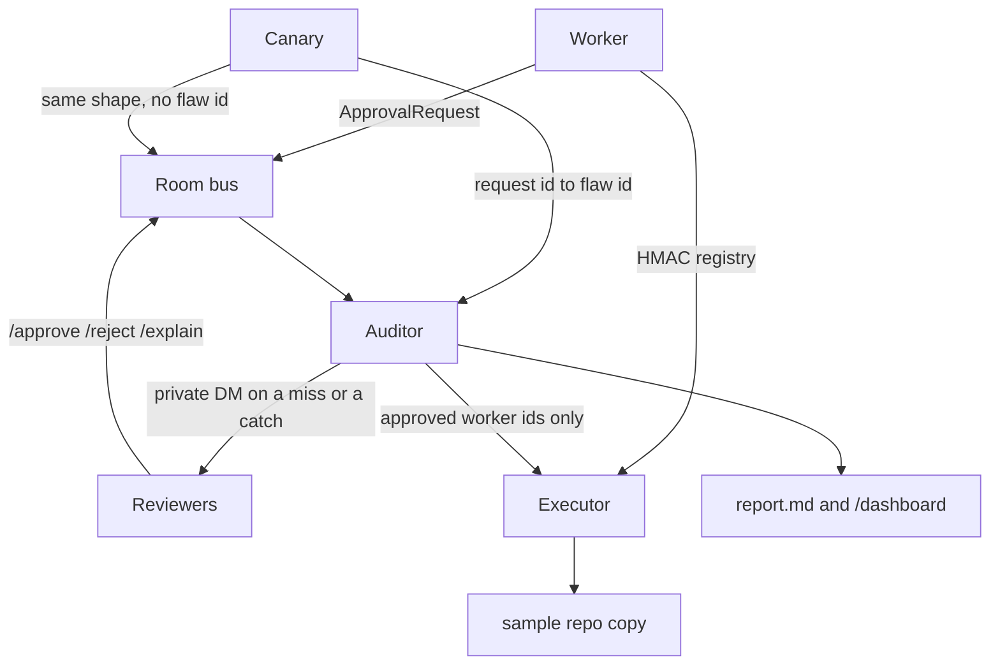

# Fire Drill

Teams put a human approve step in front of risky agent actions, and then nobody measures whether the human actually reads. Fire Drill is a shared room where a worker does real, safe edits, a canary posts the same kind of request with a deliberate flaw, and an auditor — the only one who knows which is which — times the decision, catches rubber-stamping, and writes the report. The canary never executes.

## Quick start

```bash
make setup
make test
firedrill run-demo --offline
firedrill report
firedrill verify
```

`make setup` creates a virtualenv, `auditor_private/` (mode 0700), and a gitignored `.env`. It installs `firedrill` into `.venv/bin`. Put that on `PATH` with `export PATH="$PWD/.venv/bin:$PATH"`, or prefix the drill commands with `uv run`. The demo runs without an API key. Add `XAI_API_KEY` only when you want the worker's one-line summaries to come from Grok; leave it empty and the offline templates are used.

## Architecture



The room bus is `LocalAdapter` (SQLite) unless you point `--adapter` at Mattermost or Switch. The executor is the only code that edits the repo, and it refuses any id that is not in the worker's HMAC registry. Canary ids are not in that registry.

## Three-minute demo

Record from the `fire-drill` directory:

```bash
make setup
firedrill run-demo --offline
firedrill report
firedrill verify
```

Narration you can read over those commands:

1. The worker posts real edits to a toy service. The canary posts twelve flawed requests in the same voice. Reviewers cannot tell them apart from the author line.
2. Avery reads and catches the canaries she is assigned. Blake approves in a few seconds and catches none. Casey catches the obvious flaws and misses the subtle ones. The flatness flag marks a reviewer with at least three decisions and a median under 8 seconds, or at least five decisions whose times barely vary and whose median is under 15 seconds. Canaries are shared across the three reviewers, with ties going to Avery.
3. `firedrill report` prints the headline from the database. The limits section says this is a method demo, not a significance claim.
4. `firedrill verify` recomputes SHA-256 of the revealed key and salt and checks it against the commitment posted when the drill started. The command prints the hash, not the key.

`firedrill replay demo/recorded_drill.jsonl` repeats that drill from the recording. The recording has no flaw ids. Replay reads the request-to-flaw map from `auditor_private/recorded_key.json`, which `run-demo` writes and git does not track. A live room uses `firedrill consent <reviewer>` (the person types `/optin`) and then `firedrill start --adapter local|mattermost|switch`. That command posts the approval requests, reads `/approve`, `/reject`, and `/explain` from the adapter, and sends the private canary reveals on the same adapter.

## Running on Switch

The room template is `switch/room-template.yaml`. It is template language version 1 and it creates the room, the roles, and the instructions. It does not create agents, and it has no `provider`, `location`, or `directory`. Those fields are how Switch Console places a coding agent, and the Fire Drill worker, canary, and auditor are external processes.

Register the three bots before you use the template. The steps below are the ones published in the agent protocol. They were not run against a live server here.

1. Set `SWITCH_BASE_URL` to the bridge address. `GET /health` is the public probe. A 401 means the host is right and the path is wrong.
2. On the Gateway **API Keys** page, create a key of type `registration`. Do not call `POST /agents/register-known`. That route registers only the agent types Switch Console runs.
3. Register each bot once with `POST /agents` and that key as `Authorization: Bearer`. The body needs `name`, `description`, `connector_type`, and `integration_profile`. The profile needs `connection_model`, `message_exchange`, `pre_invocation_mediation`, `post_invocation_mediation`, and `event_reporting` (send `[]` for those three unless you need them). Use the names `worker`, `canary`, and `auditor`. The response is `{id, api_key}`, and the API key is shown once. This adapter does not open `/agents/{agent_id}/connection/ws`, so `connection_model` `session_passive` matches a bot that reads the room when it polls, and `message_exchange` is `true`.
4. A new agent answers its owner only. Leave the canary and the auditor there. For the worker, call `POST /agents/{agent_id}/ops/update_agent_detail` with the bot's own API key and `{"agent_id": "<agent_id>", "addressing": "anyone"}`. The published values are `owner_only`, `owner_and_owner_agents`, and `anyone`.
5. Use the template from Switch Console, or post the same document to `POST /rooms/from-yaml`. The room names `worker`, `canary`, and `auditor`. If one of those agents is missing, the run stops. The template does not install a coding agent.
6. Put one bot's id and API key in `.env`: `SWITCH_BASE_URL`, `SWITCH_AGENT_ID`, `SWITCH_API_TOKEN`, `SWITCH_ROOM_ID`. `SWITCH_CONNECTION_ID` is optional. The adapter sends it only when it is set.
7. `firedrill up --adapter switch` calls `GET /health` and, when the token is set, posts one readiness line with `POST /agents/{agent_id}/message` and `{"room_id", "content"}`.
8. `firedrill start --adapter switch` runs the seeded drill on that bus until the first private canary reveal. That call raises `NotSupported`. `send_targeted_message` is in the operation catalog, and other participants still see it, so it is not a private channel. There is no reaction operation. Use `/approve` and `/reject` in the room. One Switch agent id cannot honestly post as three human authors; the adapter keeps local author and role labels only after a confirmed `read_context`.

Verified against the published agent protocol and `docs/TEMPLATES.md`, not against a live server:

- `GET /health`
- `POST /agents` registration fields, and the warning not to use `register-known`
- `POST /agents/{agent_id}/ops/update_agent_detail` with `addressing`
- `POST /agents/{agent_id}/message` with `{room_id, content}`
- `GET /agents/{agent_id}/ops`, then `read_context` only with argument names that schema lists
- `POST /agents/{agent_id}/ops/{operation}` with the bearer token and optional `X-Switch-Connection-Id`

Not verified live: registration, addressing, the WebSocket, applying the template, posting, and reading a room. This checkout has no `SWITCH_BASE_URL`. `kswitch` on this machine is Kerberos, not a Switch CLI. Mattermost `GET /api/v4/system/ping` was verified live on the local preview container. Mattermost posting and `GET` of channel posts were checked against the API document, not against a token.

## Answer-key threat model

The answer key is the map from request id to flaw, plus the bytes in `auditor_private/key.json`. That directory is mode 0700 and is not in git. `make setup-auditor` writes `AUDITOR_TOKEN` and `CANARY_INGEST_TOKEN` into `auditor_private/tokens.json` (mode 0600). On Linux it runs `sudo useradd --system firedrill-auditor`, then `chown` and `chmod 700` on that directory, when non-interactive sudo works. On macOS it keeps `sysadminctl`. When the user cannot be created, the script prints a warning and falls back to token-only isolation.

`firedrill serve` starts the token-gated FastAPI service with uvicorn on `127.0.0.1`. `firedrill run-demo` and `firedrill start` launch that service as a subprocess and stop it when the drill finishes. The canary sends `{request_id, flaw_id}` only by `POST /mappings` with `CANARY_INGEST_TOKEN`. That token cannot read the key or the mappings. `AUDITOR_TOKEN` can read the key, the mappings, and `/dashboard`. The worker and the canary receive 401 on the key. The canary process is not given `WORKER_SECRET`, and `executor.py` will not apply an id the worker did not sign.

At the start the auditor posts `SHA-256(key.json bytes + newline + salt)`. At the end it posts the key and the salt so anyone can recompute the hash. A miss is a private DM (`PRIVATE CANARY RESULT`) to the reviewer who approved the canary. That text is not written to the room log. A correct rejection gets a private "nice catch" and still does not execute.

## Adapters

`firedrill up` defaults to the local SQLite room. That path is what the tests and the offline demo run.

Mattermost uses the preview image in `docker-compose.yml` on port 8065. That image has no `linux/arm64` manifest, so the compose file pins `platform: linux/amd64` for Apple Silicon. The adapter uses only these API v4 calls: `GET /api/v4/system/ping`, `GET /api/v4/users/me`, `POST /api/v4/posts` (including the documented `props` bag), `GET /api/v4/channels/{channel_id}/posts` to poll replies, `POST /api/v4/reactions`, and `POST /api/v4/channels/direct` for private reveals. `MM_TOKEN` is the bot or personal access token. Set `MM_CHANNEL_ID`, and set `MM_USER_AVERY`, `MM_USER_BLAKE`, and `MM_USER_CASEY` to the Mattermost user ids that receive canary DMs. The tool does not guess an admin password. If the server is up and the token is missing, `firedrill up --adapter mattermost` exits with those instructions. Posting was not exercised live: the local `.env` has an empty token.

Switch is covered in [Running on Switch](#running-on-switch). No Switch server was reached from this checkout.

## Citations

- Anthropic, Claude Code auto mode: users accept 93% of permission prompts. <https://www.anthropic.com/engineering/claude-code-auto-mode>
- Anthropic, planted dangerous commands were caught 13.6% of the time. <https://claude.com/resources/articles/auto-mode-default-in-claude-code>
- Lane et al., Harvard Business School field experiment: LLM narrative explanations raised alignment with the AI by about 19 percentage points under cognitive load. <https://www.hbs.edu/faculty/Pages/item.aspx?num=66193>
- EU AI Act Article 14(4)(b): overseers must remain aware of the tendency to rely automatically on the output (automation bias). <https://ai-act-service-desk.ec.europa.eu/en/ai-act/article-14>
- Cemri et al., Berkeley, MAST: task verification failures are about 23.5% of multi-agent failures. <https://arxiv.org/abs/2503.13657>

The twelve canaries are tagged with MAST modes from that taxonomy, including disobeying the task or the role, ignoring another agent's input, a plan that does not match the diff, stopping early, and weak or wrong verification.

## Limits

The offline demo is 50 real edits and 12 canaries, decided by three simulated reviewers. That is enough to show the measurement. It is a small sample; it demonstrates the method, not statistical significance. Catch rate, median times, and the flatness flag are computed from the run. The headline in the report is that computation, not a number baked into the program.

## License

MIT. See [LICENSE](LICENSE).

## Deploy on Render

The repo ships a read-only public dashboard of an offline drill as a Render static site.

- `scripts/export_public_dashboard.py` turns `report.md` into `public/index.html` and `public/report.md`. It publishes aggregate results only and refuses to write anything that mentions flaw ids, tokens, or the key file.
- `render.yaml` defines a static site called `fire-drill`. The build runs the offline demo and the export script, then publishes `public/`.
- To deploy, create a Blueprint in the Render dashboard pointing at this repo, or create a static site with the same build command and publish path `public`.
- Public URL: `https://fire-drill.onrender.com` (placeholder, confirm after first deploy).

The live auditor service (`firedrill serve`) is not deployed. It binds to 127.0.0.1 and keeps the answer key private.
