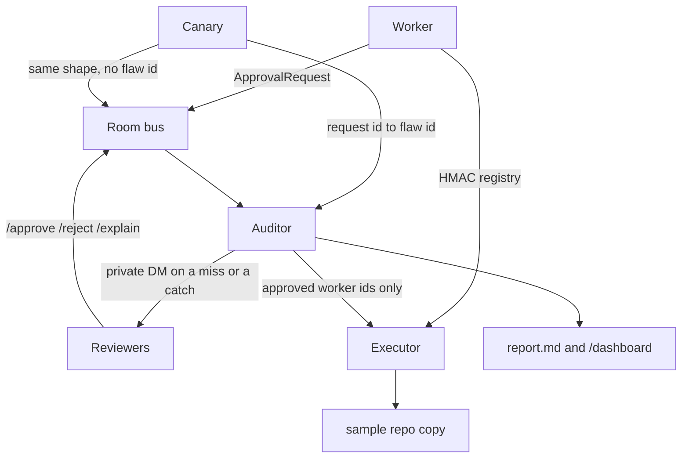

# Fire Drill

Teams put a human approve step in front of risky agent actions, and then nobody measures whether the human actually reads. Fire Drill is a shared room where a worker does real, safe edits, a canary posts the same kind of request with a deliberate flaw, and an auditor — the only one who knows which is which — times the decision, catches rubber-stamping, and writes the report. The canary never executes.

## Quick start

```bash
make setup
make test
firedrill run-demo --offline
firedrill report
firedrill verify
```

`make setup` creates a virtualenv, `auditor_private/` (mode 0700), and a gitignored `.env`. It installs `firedrill` into `.venv/bin`. Put that on `PATH` with `export PATH="$PWD/.venv/bin:$PATH"`, or prefix the drill commands with `uv run`. The demo runs without an API key. Add `XAI_API_KEY` only when you want the worker's one-line summaries to come from Grok; leave it empty and the offline templates are used.

## Architecture



The room bus is `LocalAdapter` (SQLite) unless you point `--adapter` at Mattermost or Switch. The executor is the only code that edits the repo, and it refuses any id that is not in the worker's HMAC registry. Canary ids are not in that registry.

